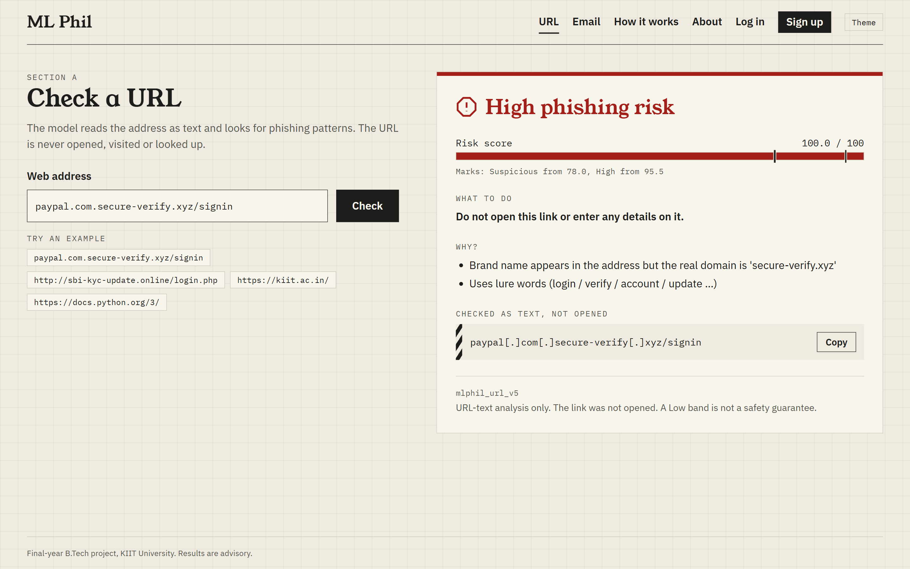
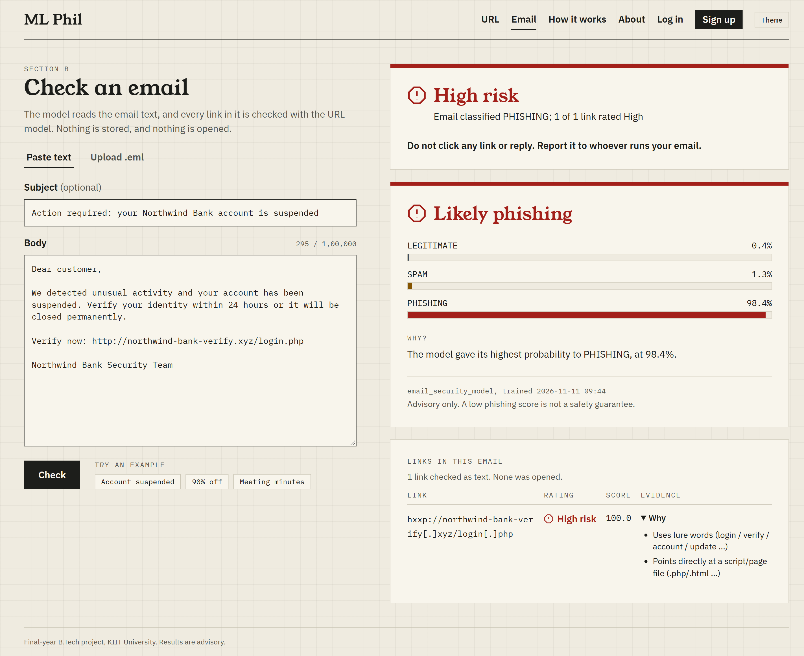
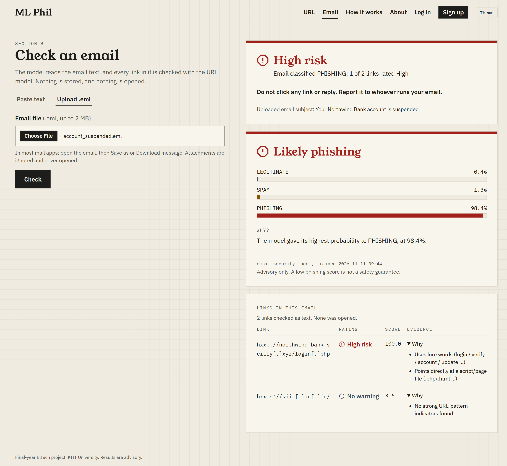
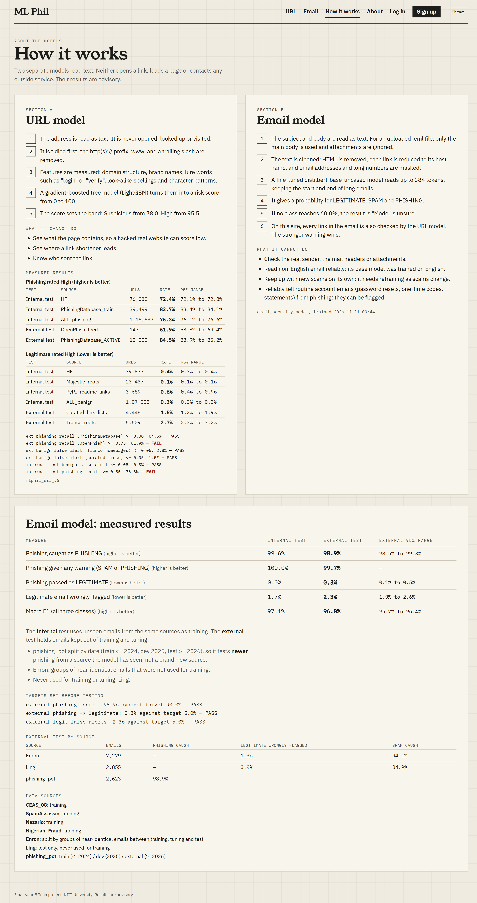
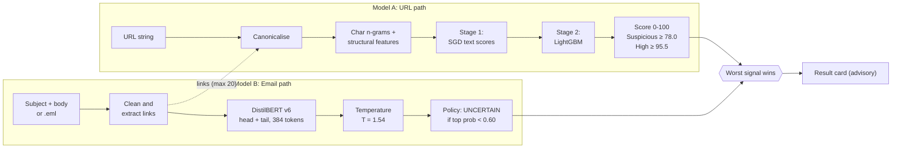
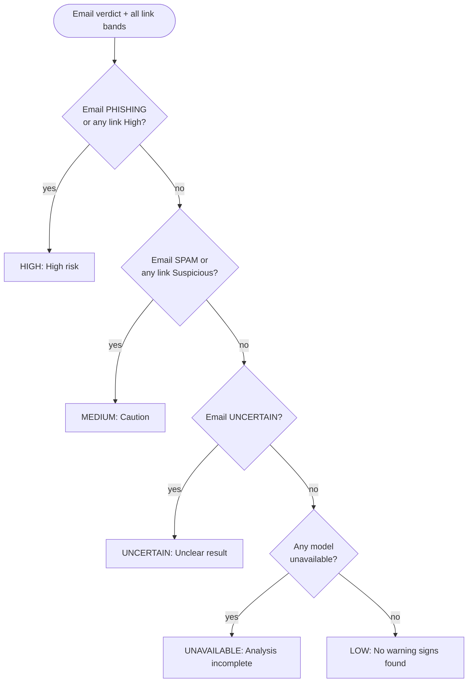
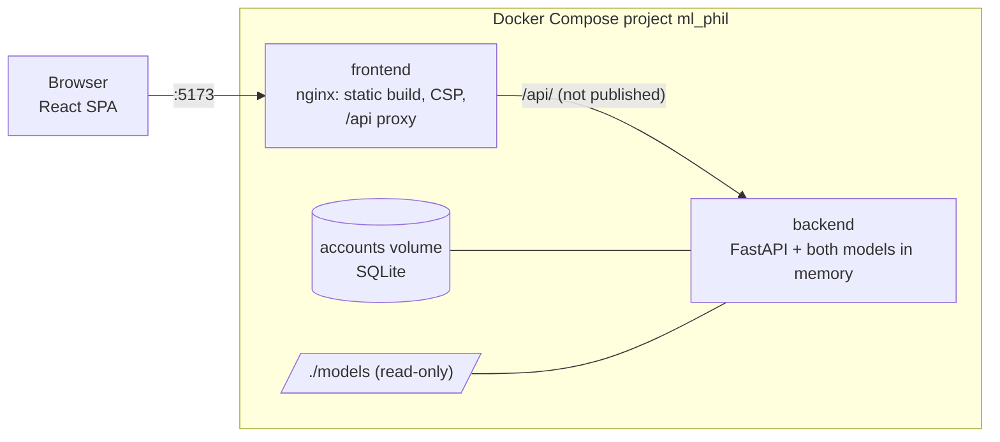

<div align="center">

# TrueNexus

**An integrated machine learning system for URL and email phishing detection**

*Connecting Trust. Detecting Deception.*

B.Tech (CSE) final-year project · School of Computer Engineering, KIIT Deemed to be University, Bhubaneswar · November 2026


</div>

TrueNexus checks a **URL** or an **email** (pasted, or uploaded as `.eml`) with two trained models and shows an **advisory** result. Every link found inside an email is also scored by the URL model, and the **worst signal wins**.

> **It is advisory, never a guarantee.** The site never says "safe". Nothing you submit is opened, fetched, stored or logged. If a model is missing or crashes, the site shows *Analysis unavailable*, never a clean result.

---

## Screenshots

| URL check: High phishing risk | Email check with links |
|:---:|:---:|
|  |  |
| **Uploaded `.eml` (attachment ignored)** | **How it works: measured results** |
|  |  |

Light and dark themes, laptop and phone layouts: see [`screenshots/`](screenshots/) and [`CAPTIONS.md`](screenshots/CAPTIONS.md).

---

## How it works



### Overall verdict (never averaged)



### Deployment



---

## The two models

### Model A: URL risk model (`mlphil_url_v6`)

Reads the URL **string only** (never resolves or visits it). Two-stage stacked ensemble: hashed character n-gram text models (host 2-5, path 3-5, word tokens) produce out-of-fold scores, which join 46 structural, look-alike, language-model and TLD features in a **LightGBM** classifier. Splits are grouped by registered domain, and format shortcuts (scheme, `www.`, trailing slash) are removed by canonicalisation. The bundle is pickle-free.

| Cohort (domain-disjoint) | Measure | High band |
|---|---|---|
| Phishing.Database | phishing caught | **84.5%** |
| OpenPhish | phishing caught | 61.9% |
| Tranco top sites | false alerts | **2.7%** |
| Curated legitimate links | false alerts | **1.5%** |
| Internal test (benign) | false alerts | 0.3% |
| Internal test (phishing) | phishing caught | 76.3% |

Pre-registered criteria: **4 of 6 pass**. The two failures (OpenPhish recall 61.9% vs 75%, internal phishing recall 76.3% vs 85%) are reported, not hidden. Weakness: adding a harmless `?lang=en` pushes about 18% of phishing URLs down one band. Compared with v5 on the same 22,204 URLs, v6 trades a few points of recall for fewer false alerts (AUC 0.971 vs 0.974).

### Model B: email classifier (v6, DistilBERT, 3 classes)

Fine-tuned `distilbert-base-uncased` labels subject + body as **LEGITIMATE / SPAM / PHISHING**, with head + tail truncation, temperature scaling (T = 1.5403) and an **UNCERTAIN** verdict.

```mermaid
xychart-beta
    title "Email model: v5 (unseen sources) vs v6 (locked test), %"
    x-axis ["Macro-F1", "Phishing recall", "Phish to legit", "Legit false alert"]
    y-axis "percent" 0 --> 100
    bar [73.7, 54.2, 5.1, 8.7]
    bar [96.0, 98.9, 0.3, 2.3]
```



*First bar series: v5 on never-seen sources. Second: v6 on its locked test.*

| Target (set before testing) | Required | v5 (unseen) | v6 (locked test) |
|---|---|---|---|
| Phishing recall | ≥ 0.90 | 0.542 FAIL | **0.989 PASS** |
| Phishing labelled legitimate | ≤ 0.05 | 0.051 FAIL | **0.003 PASS** |
| Legitimate false alert | ≤ 0.05 | 0.087 FAIL | **0.023 PASS** |

On the same 1,042 phishing emails from 2026, v6 catches **99.5%** vs **65.8%** for v5.

**Read these results with care.** v6's test is a date split of a source it trained on, so it measures newer phishing from a familiar source, not a brand-new one; a TF-IDF baseline also reaches 0.905 macro-F1 on it. Ling false alerts rose to 3.9%, and 5 of 8 hand-written modern legitimate emails (receipts, one-time codes) were flagged as phishing.

---

## Hard rules (enforced by tests)

| ID | Rule |
|---|---|
| R1 | Never fetch, resolve, open, preview or render a submitted URL |
| R2 | Never show "Safe" or a green tick; Low means "no warning found" |
| R3 | Fail closed: a missing or crashed model gives "Analysis unavailable" |
| R4 | Submitted URLs are shown defanged (`hxxps://example[.]com`), never clickable |
| R5 | Email content is rendered as plain text only |
| R6 | Email bodies and URLs are never stored or logged |
| R7 | Model code is imported as-is and never modified |
| R8 | No invented metrics: read from model reports, else "not yet available" |
| R9 | No stack traces, file paths or library versions in API responses |

## Features

- URL check with score bar, band marks, plain-language evidence and a "what to do" line
- Email check (paste or `.eml` upload) with probabilities and a table of every link, rated by the URL model
- Accounts: sign up, log in, delete account (SQLite, Argon2id, hashed session tokens, HttpOnly cookie)
- Rate limiting, body-size caps, security headers, strict Content Security Policy
- Light and dark themes, laptop and phone layouts, accessible badges (never colour alone)
- **177 automated tests**: 113 backend (pytest), 60 frontend (Vitest + Testing Library + MSW), 4 end-to-end (Playwright, real Chrome, real models)

## API

| Method | Path | Purpose |
|---|---|---|
| GET | `/api/health` | which models and accounts are ready |
| GET | `/api/model-info` | thresholds and measured results read from the model reports |
| POST | `/api/check-url` | score, band, evidence, defanged URL |
| POST | `/api/check-email` | verdict, probabilities, confidence |
| POST | `/api/analyze-email` | email + all links, overall verdict |
| POST | `/api/check-eml` | raw `.eml` (max 2 MB), same output as analyze-email |
| POST / GET | `/api/auth/*` | signup, login, logout, delete-account, me |

---

## Model files (not in git)

The trained weights are large, so they are not in this repository. Put these in `models/`:

| Folder | What | Where it comes from |
|---|---|---|
| `models/model_bundle/` | URL model v6, with `final_report.json` (results shown on "How it works") | Kaggle run of [`notebooks/MLPhil_URL_Phishing_Pipeline.ipynb`](notebooks/) |
| `models/email_security_model/` | Email model, with its own `email_preprocess.py` | Kaggle run of [`notebooks/email_classifier_v6.ipynb`](notebooks/) |
| `models/email_reports/` | Test results shown on "How it works" | `summary.json`, `external_metrics.csv`, `external_ci95.csv` from that run's `reports/` |

A missing model does not stop the site: that section shows "Analysis unavailable" and the rest keeps working. Missing reports only hide the figures.

## Run with Docker (one command)

```powershell
docker compose up --build
```

Open http://localhost:5173. Only the website port is published; the backend is reachable only through it. Use another port with `$env:WEB_PORT = "8080"` before the command. Accounts are kept in the Docker volume `accounts`.

## Run without Docker (PowerShell)

Backend, on port 8000:

```powershell
cd backend
py -3.12 -m venv .venv
.venv\Scripts\python -m pip install torch==2.15.0 --index-url https://download.pytorch.org/whl/cpu
.venv\Scripts\python -m pip install -r requirements.txt
$env:MLPHIL_URL_BUNDLE = "..\models\model_bundle"
$env:MLPHIL_EMAIL_MODEL_DIR = "..\models\email_security_model"
.venv\Scripts\python -m uvicorn main:app --host 127.0.0.1 --port 8000 --no-server-header
```

Website, on port 5173 (forwards `/api` to the backend):

```powershell
cd frontend
npm install
npm run dev
```

Check which models loaded: http://localhost:5173/api/health

## Tests

```powershell
cd backend;  .venv\Scripts\python -m pytest -q     # API, models, accounts, .eml
cd frontend; npm test                              # pages and results (mocked API)
cd frontend; npm run e2e                           # real browser, real models (needs Google Chrome)
```

## Accounts

Login and signup use SQLite at `data/mlphil.db` (created on first start, not in git). It stores name, email, an Argon2id password hash and hashed session tokens; never checked URLs or emails. Checks do not need an account. To reset all accounts, stop the backend and delete `data/mlphil.db`. Set `MLPHIL_COOKIE_SECURE=1` when the site is served over HTTPS.

## Project layout

```
backend/     FastAPI app: routers/ (url, email, combined, meta, auth), services/, vendor/ (URL service, unchanged), tests/
frontend/    React + Vite + TypeScript + Tailwind: src/pages, src/components, tests/, e2e/, nginx.conf
notebooks/   Kaggle training notebooks (email v6, URL pipeline)
screenshots/ Light, dark and phone screenshots with captions
docker-compose.yml   two services: backend (models) and frontend (nginx)
SPEC.md      specification as built
PROJECT_HISTORY.md   work log and key numbers
```

Internal names (`mlphil_*`, the Compose project `ml_phil`) keep the project's earlier working name, ML Phil.

## Known limitations

- Email v6 has not been tested on a fully new phishing source; it flags many modern genuine service emails; its phishing threshold (0.05) sits at the edge of the tuning grid.
- URL v6 meets 4 of 6 targets and loses some phishing to harmless query parameters.
- Text only: no page content, sender authentication, attachments or images. The email model's base is English-only.
- Local single-server demo. Signup reveals whether an email is registered.

Next steps: email v7 with modern legitimate hard negatives and a never-seen phishing source; URL v7 with higher OpenPhish recall and robustness to query parameters.

## Team

| Name | Roll no. |
|---|---|
| Vishwesh Shukla | 23052124 |
| Amrita Bhattacharyya | 2305515 |
| Jonnadula Hansika | 23051914 |
| Adriti Purkayastha | 23051890 |
| Anusha Bakshi | 2305520 |
| Shantanu Roy | 2305811 |

Supervisor: **Ms. Indu Chaudhary**, Assistant Professor, School of Computer Engineering, KIIT.

## Data and licences

- Phishing email corpora curated by Champa et al. (Kaggle `naserabdullahalam/phishing-email-dataset`): CC BY 4.0
- `phishing_pot` by rf-peixoto: **CC BY-NC 4.0, non-commercial use only**
- Enron and Ling-Spam corpora; Nazario phishing corpus
- URL sources: Hugging Face `ealvaradob/phishing-dataset`, Majestic Million, Phishing.Database, OpenPhish, Tranco, PyPI project links, curated link lists
- DistilBERT (`distilbert-base-uncased`) by Hugging Face: Apache 2.0

The repository has no licence file yet. Until one is added, all rights are reserved by the authors.
